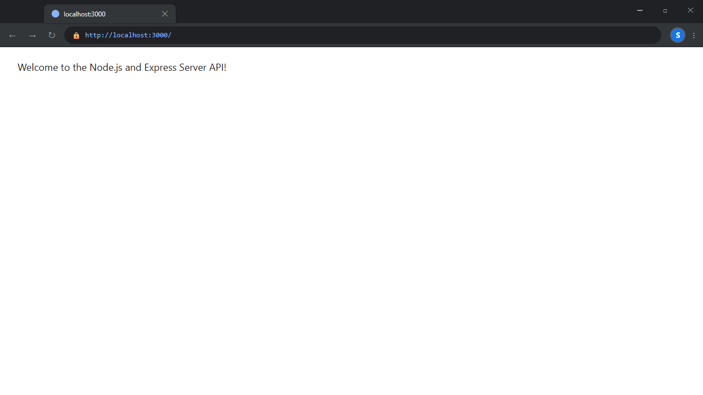
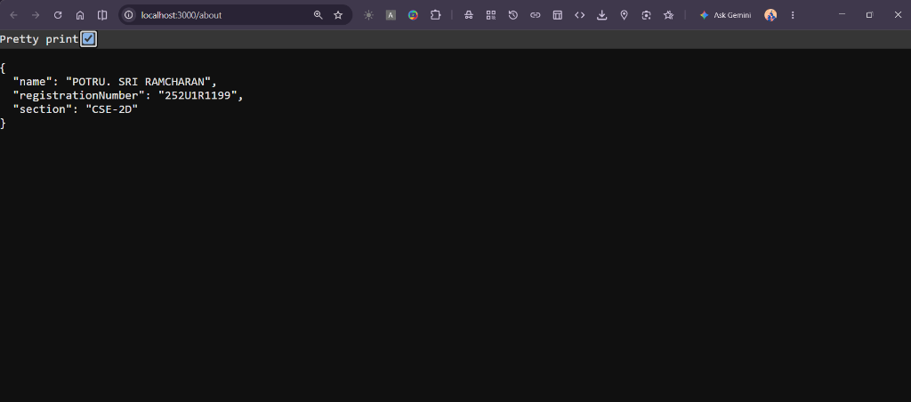
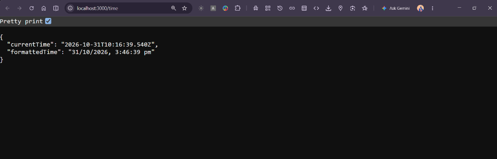
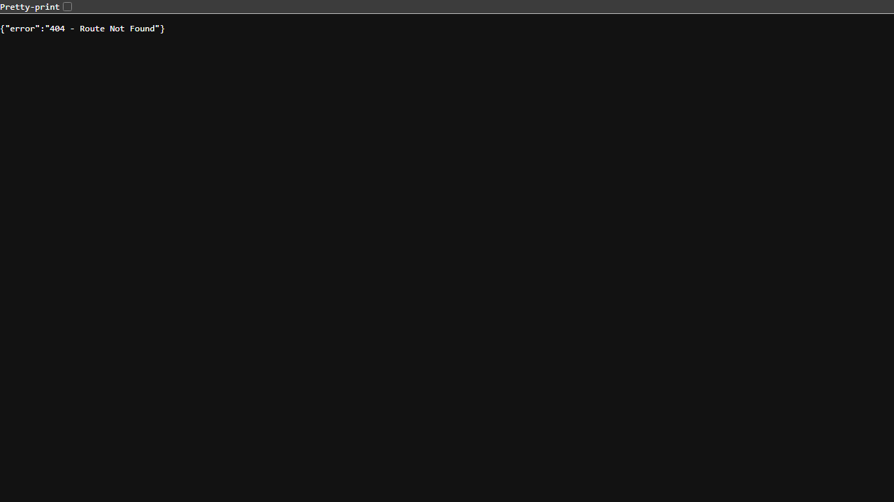

# Lab 1: Node.js and Express server

## Student Information

- **Student Name:** POTRU. SRI RAMCHARAN
- **Registration Number:** `252U1R1199`
- **Section:** `CSE-2D`
- **Course:** Backend Development Fundamentals
- **Lab Number:** Lab 01
- **Repository Name:** `BDF-LAB-1`

**Live Link:** Localhost (`http://localhost:3000`) *(Cloud deployment on Render pending free-tier verification)*

---

## Objective
The objective of this laboratory assignment is to learn backend development fundamentals using Node.js and Express.js:
1. Build a basic HTTP server using Node's built-in `http` module.
2. Build an Express.js server with proper routing and response handling.
3. Implement dynamic data responses (current time) and structured JSON outputs.
4. Implement a 404 handler for invalid routes.
5. Organize the project files cleanly with `.gitignore` and version control.

---

## How to Run

### 1. Prerequisites
- Node.js (v18 or higher)
- npm (Node Package Manager)

### 2. Installation
Open terminal, navigate to the `lab-01` folder, and install dependencies:
```bash
cd lab-01
npm install
```

### 3. Environment Variables (Optional)
You can optionally create a `.env` file in `lab-01/`:
```env
PORT=3000
STUDENT_NAME=POTRU. SRI RAMCHARAN
STUDENT_REG_NO=252U1R1199
STUDENT_SECTION=CSE-2D
```

### 4. Start Commands

- **Run Basic HTTP Server:**
  ```bash
  npm run basic
  ```
  Server runs at: `http://localhost:3000/`

- **Run Express Server:**
  ```bash
  npm start
  ```
  Server runs at: `http://localhost:3000`

---

## Endpoints / Scripts Table

### Available Scripts
| Script Command | Target File | Purpose |
|---|---|---|
| `npm run basic` | `basic-server.js` | Runs the basic HTTP server |
| `npm start` | `server.js` | Runs the Express server |

### API Endpoints
| Method | Path | Expected Status | Response Format | One-line Description |
|---|---|---|---|---|
| `GET` | `/` | `200 OK` | `text/html` | Returns welcome message |
| `GET` | `/about` | `200 OK` | `application/json` | Returns JSON with student name, registration number, and section |
| `GET` | `/time` | `200 OK` | `application/json` | Returns current date and time dynamically |
| `*` (All) | `/*` (Invalid) | `404 Not Found` | `application/json` | Returns 404 error message for unknown routes |

---

## Verified Test Results

| Test Case | Route Tested | Expected Status | Actual Status | Result |
|---|---|---|---|---|
| 1 | `GET /` (Basic Server) | `200 OK` | `200 OK` | **PASSED** |
| 2 | `GET /` (Express Server) | `200 OK` | `200 OK` | **PASSED** |
| 3 | `GET /about` (Express Server) | `200 OK` | `200 OK` | **PASSED** |
| 4 | `GET /time` (Express Server) | `200 OK` | `200 OK` | **PASSED** |
| 5 | `GET /invalid-route` (Express Server) | `404 Not Found` | `404 Not Found` | **PASSED** |

---

## Screenshots

Below are the output screenshots for each endpoint running on localhost:3000:

### 1. Home Endpoint (`GET /`)


### 2. About Endpoint (`GET /about`)


### 3. Dynamic Time Endpoint (`GET /time`)


### 4. 404 Route Not Found


---

## Notes: Problems Faced and How I Solved Them

1. **Port Already in Use (`EADDRINUSE: :::3000`):**
   - *Problem:* When switching from `basic-server.js` to `server.js`, running `npm start` threw an `EADDRINUSE` error because the basic server was still running in another terminal window.
   - *Solution:* Stopped the background process on port 3000 before running the Express server.
2. **Browser Hanging Indefinitely:**
   - *Problem:* In the initial code for `/about`, I forgot to complete the response using `res.json()`, causing the browser tab to keep spinning without displaying output.
   - *Solution:* Added `res.status(200).json(...)` to properly return the JSON response and close the HTTP connection.
3. **404 Catch-All Route Blocking Other Endpoints:**
   - *Problem:* Initially placed the `app.use()` 404 handler before the `/time` and `/about` routes, which caused all requests to return 404.
   - *Solution:* Moved the 404 middleware to the very bottom of `server.js` so it only runs if no matching route is found above it.
4. **PowerShell Script Execution Restriction:**
   - *Problem:* On Windows, running `npm` gave an execution policy error (`File npm.ps1 cannot be loaded`).
   - *Solution:* Ran `npm.cmd` directly in the terminal to execute npm commands without restriction.

---

## Viva Questions and Answers

### Q1: What is the difference between Node's `http` module and Express.js?
**A:** Node's built-in `http` module is low-level and requires manual parsing of URLs, request methods, and headers. Express.js is a framework built on top of `http` that simplifies routing, middleware, and sending responses like JSON with built-in methods like `res.json()`.

### Q2: Why use `process.env.PORT || 3000`?
**A:** In cloud hosting platforms (like Render or Railway), the platform assigns an arbitrary port via the `PORT` environment variable. Using `process.env.PORT || 3000` makes the code run on the host's assigned port in production while defaulting to 3000 locally.

### Q3: Why should `node_modules` be added to `.gitignore`?
**A:** The `node_modules` folder contains thousands of files and takes a lot of storage space. It shouldn't be pushed to GitHub because anyone can recreate it by running `npm install`, which reads the dependencies listed in `package.json`.

### Q4: Why is the 404 route handler placed at the end of `server.js`?
**A:** Express checks routes sequentially from top to bottom. If the 404 handler were at the top, every request would hit it and return 404. Placing it at the bottom ensures it only triggers when none of the defined routes match the request.
