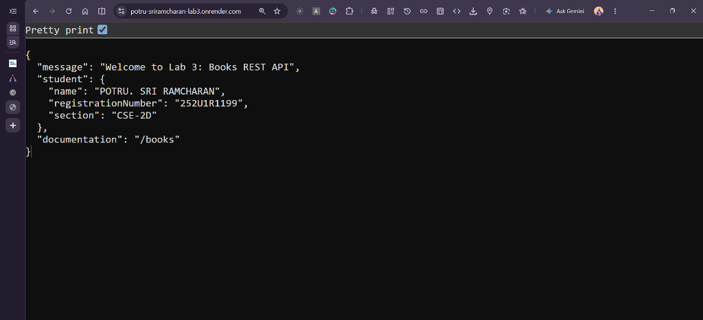
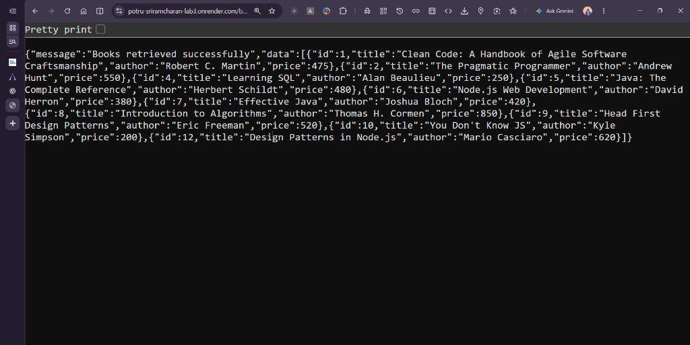
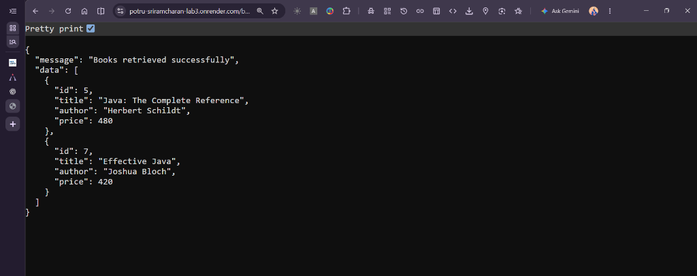
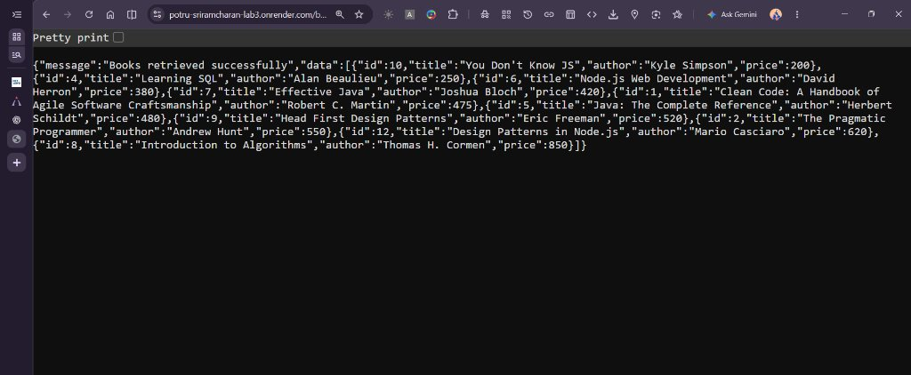
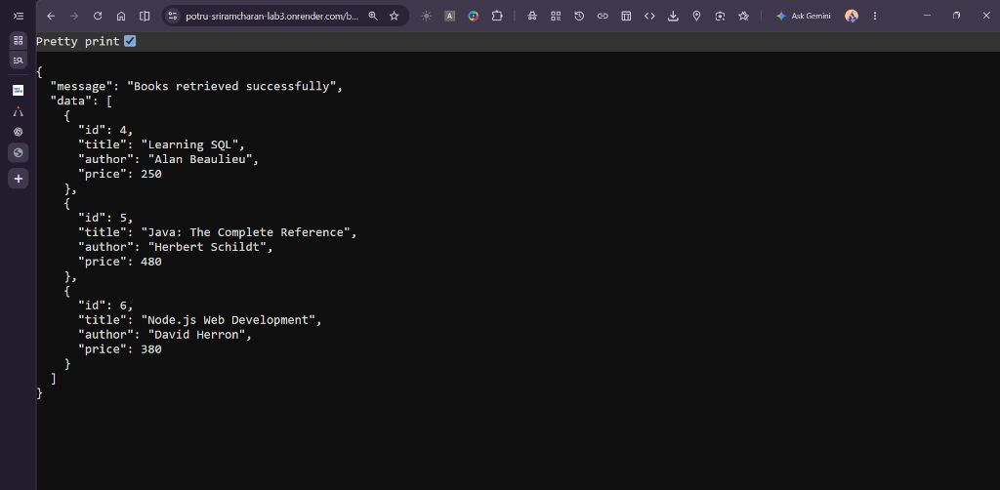
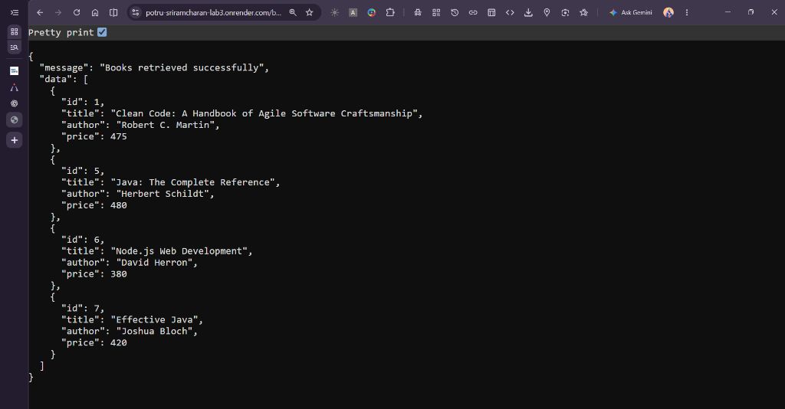
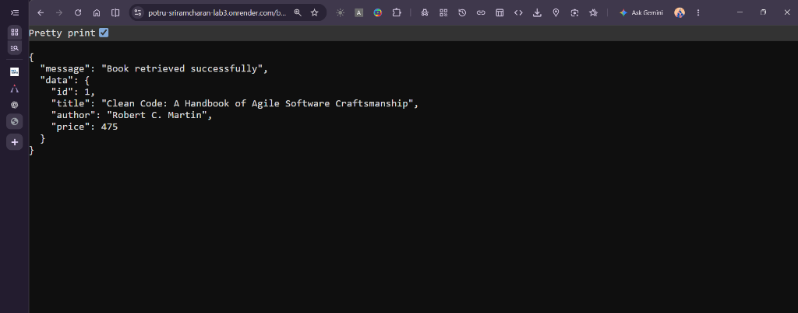

# Lab 3: REST API, Query Parameters, Validation and Debugging

## Student Information

- **Student Name:** POTRU. SRI RAMCHARAN
- **Registration Number:** `252U1R1199`
- **Section:** `CSE-2D`
- **Course:** Backend Development Fundamentals
- **Lab Number:** Lab 03
- **Repository Name:** `BDF-LAB-1`

---

## Live Deployments (Render)

### Lab 3: Books REST API Service

- **Live API Base URL:** [https://potru-sriramcharan-lab3.onrender.com](https://potru-sriramcharan-lab3.onrender.com)
- **Get All Books:** [https://potru-sriramcharan-lab3.onrender.com/books](https://potru-sriramcharan-lab3.onrender.com/books)
- **Search (Java):** [https://potru-sriramcharan-lab3.onrender.com/books?search_q=Java](https://potru-sriramcharan-lab3.onrender.com/books?search_q=Java)
- **Sorting (Price ASC):** [https://potru-sriramcharan-lab3.onrender.com/books?order_by=price&order=ASC](https://potru-sriramcharan-lab3.onrender.com/books?order_by=price&order=ASC)
- **Pagination (Limit=5, Offset=0):** [https://potru-sriramcharan-lab3.onrender.com/books?limit=5&offset=0](https://potru-sriramcharan-lab3.onrender.com/books?limit=5&offset=0)
- **Price Range Filter (100 to 500):** [https://potru-sriramcharan-lab3.onrender.com/books?min_price=100&max_price=500](https://potru-sriramcharan-lab3.onrender.com/books?min_price=100&max_price=500)
- **Single Book (ID 1):** [https://potru-sriramcharan-lab3.onrender.com/books/1](https://potru-sriramcharan-lab3.onrender.com/books/1)

#### Public Deployment Verification Table (Tested Live on Render)
| Endpoint Tested | HTTP Method | Expected Status | Actual Status | Live Verification Result |
|---|---|---|---|---|
| `/` (Welcome & Metadata) | `GET` | `200 OK` | `200 OK` | **VERIFIED LIVE** |
| `/books` (All Books) | `GET` | `200 OK` | `200 OK` | **VERIFIED LIVE** |
| `/books/1` (Book by ID) | `GET` | `200 OK` | `200 OK` | **VERIFIED LIVE** |
| `/books?search_q=java` | `GET` | `200 OK` | `200 OK` | **VERIFIED LIVE** |
| `/books?order_by=price&order=ASC` | `GET` | `200 OK` | `200 OK` | **VERIFIED LIVE** |
| `/books?limit=5&offset=0` | `GET` | `200 OK` | `200 OK` | **VERIFIED LIVE** |
| `/books?min_price=100&max_price=500` | `GET` | `200 OK` | `200 OK` | **VERIFIED LIVE** |
| `/books` (Create Book) | `POST` | `201 Created` | `201 Created` | **VERIFIED LIVE** |
| `/books/:id` (Update Book) | `PUT` | `200 OK` | `200 OK` | **VERIFIED LIVE** |
| `/books/:id` (Delete Book) | `DELETE` | `200 OK` | `200 OK` | **VERIFIED LIVE** |
| `/books` (Missing Title) | `POST` | `400 Bad Request` | `400 Bad Request` | **VERIFIED LIVE** |
| `/books/99999` (Nonexistent ID) | `GET` | `404 Not Found` | `404 Not Found` | **VERIFIED LIVE** |
| `/books?order_by=invalid` | `GET` | `400 Bad Request` | `400 Bad Request` | **VERIFIED LIVE** |

---

## Objective
The objective of this laboratory assignment is to design, implement, test, and debug a production-ready Express.js REST API backed by an SQLite database:
1. Implement full CRUD (Create, Read, Update, Delete) operations using standard HTTP methods (`GET`, `POST`, `PUT`, `DELETE`).
2. Construct advanced filtering, partial text searching with SQL `LIKE`, dynamic multi-column sorting with allowlists, and offset-based pagination.
3. Validate client query parameters and request bodies, rejecting invalid payloads with appropriate HTTP 400 Bad Request responses.
4. Guarantee 100% protection against SQL injection vulnerabilities through strict parameterization.
5. Understand common backend errors through structured debugging exercises (`EADDRINUSE`, wrong import path, table-name typos, and missing `await`).
6. Build a complete 21-test automated Postman collection.
7. Configure production persistence with Render persistent disks.

---

## Technologies Used
- **Runtime:** Node.js (v18+ / v24)
- **Framework:** Express.js (v4.21.2)
- **Database:** SQLite3 (`sqlite3` v5.1.7)
- **Query Language:** SQL (Parameterized queries)
- **API Testing:** Postman & Node.js HTTP Automated Test Harness
- **Cloud Deployment:** Render Web Services
- **Version Control:** Git & GitHub

---

## Project Structure
```text
BDF-LAB-1/
├── lab-01/                             # Lab 1: Basic & Express servers
├── lab-03/                             # Lab 3: REST API, Query Params & Validation
│   ├── .env.example                    # Environment variable template
│   ├── .gitignore                      # Ignores node_modules, .env, and temp files
│   ├── books.db                        # SQLite database file with initial sample seed
│   ├── database.js                     # SQLite connection, schema creation & seed logic
│   ├── package.json                    # Project dependencies and start script
│   ├── package-lock.json               # Locked dependency tree
│   ├── README.md                       # Comprehensive documentation & evaluation report
│   ├── server.js                       # Express application with all REST API endpoints
│   ├── postman/                        # Exported Postman collection
│   │   └── Lab3-REST-API-Testing.json  # 21 automated test cases (success & failures)
│   └── screenshots/                    # Verified output screenshots
│       ├── get-all-books.png           # GET /books
│       ├── not-found-404.png           # GET /books/99999 (404)
│       ├── pagination.png              # GET /books?limit=3&offset=2
│       ├── price-filtering.png         # GET /books?min_price=300&max_price=500
│       ├── search-results.png          # GET /books?search_q=Java
│       ├── sorting-results.png         # GET /books?order_by=price&order=ASC
│       ├── successful-delete.png       # DELETE /books/:id
│       ├── successful-post.png         # POST /books
│       ├── successful-put.png          # PUT /books/:id
│       └── validation-error-400.png    # POST /books (400 validation error)
├── render.yaml                         # Render deployment specification
└── README.md                           # Course directory manifest
```

---

## Database Schema

The database `books.db` contains a single table named `books`:

```sql
CREATE TABLE IF NOT EXISTS books (
  id INTEGER PRIMARY KEY AUTOINCREMENT,
  title TEXT NOT NULL,
  author TEXT NOT NULL,
  price REAL NOT NULL
);
```

### Fields Description:
| Column | Type | Constraints | Description |
|---|---|---|---|
| `id` | `INTEGER` | `PRIMARY KEY AUTOINCREMENT` | Unique identifier for each book record |
| `title` | `TEXT` | `NOT NULL` | Full title of the book |
| `author` | `TEXT` | `NOT NULL` | Name of the author |
| `price` | `REAL` | `NOT NULL` | Retail price in currency units (numeric, non-negative) |

### Automatic Database Initialization & Seeding:
When the server starts, `db.initializeDatabase()` executes automatically:
- Creates the `books` table if it does not exist.
- Checks `SELECT COUNT(*) FROM books`.
- If the table is empty, it seeds 10 sample computer science and software development books.
- If records already exist, it preserves them without duplicate seeding or overwriting.

---

## How to Install and Run Locally

### 1. Prerequisites
- [Node.js](https://nodejs.org/) (v18 or higher)
- npm (Node Package Manager)

### 2. Installation
Navigate into the `lab-03` directory and install dependencies:
```bash
cd lab-03
npm install
```

### 3. Environment Variables (Optional)
Copy `.env.example` to create your `.env` file if custom ports or paths are needed:
```bash
cp .env.example .env
```
Contents of `.env`:
```env
PORT=3000
# DB_DIR=/var/data (Optional: for Render persistent disks)
# DB_PATH=/var/data/books.db
```

### 4. Running the Server
```bash
npm start
```
Terminal Output:
```text
[Database] Connecting to SQLite at: C:\...\lab-03\books.db
[Server] Express server running on port 3000
[Database] Connected to SQLite database successfully.
[Database] Table already seeded with 10 books. Preserving existing records.
```

---

## API Endpoints Documentation

| Method | Endpoint | Expected Status | Description |
|---|---|---|---|
| `GET` | `/` | `200 OK` | Welcome message, student details, and API documentation link |
| `GET` | `/books` | `200 OK` | Retrieves books with optional search, sorting, filtering, and pagination |
| `GET` | `/books/:id` | `200 OK` / `404 Not Found` | Retrieves a single book by its primary key ID |
| `POST` | `/books` | `201 Created` / `400 Bad Request` | Creates a new book record with input validation |
| `PUT` | `/books/:id` | `200 OK` / `400 Bad Request` / `404 Not Found` | Updates an existing book record by ID |
| `DELETE` | `/books/:id` | `200 OK` / `404 Not Found` | Deletes an existing book record by ID |

---

## Query Parameters for `GET /books`

The `GET /books` endpoint supports rich filtering, searching, sorting, and pagination:

| Parameter | Type | Default Value | Allowlist / Constraints | Description |
|---|---|---|---|---|
| `search_q` | String | *None* | Trimmed non-empty string | Performs partial case-insensitive title search using SQL `LIKE %search_q%` |
| `order_by` | String | `'id'` | `['id', 'title', 'author', 'price']` | Column to sort by. Checked against an explicit allowlist to prevent SQL injection |
| `order` | String | `'ASC'` | `['ASC', 'DESC']` (Case-insensitive) | Direction of sort order |
| `limit` | Integer | `10` | Positive integer (`limit > 0`) | Maximum number of records returned |
| `offset` | Integer | `0` | Non-negative integer (`offset >= 0`) | Number of records to skip for pagination |
| `min_price`| Number | *None* | Non-negative number (`>= 0`) | Minimum price threshold filter (`price >= min_price`) |
| `max_price`| Number | *None* | Non-negative number (`>= 0`) | Maximum price threshold filter (`price <= max_price`) |

> **Validation Rule:** If both `min_price` and `max_price` are provided and `min_price > max_price`, the API returns `400 Bad Request` with message: `"Invalid price range: min_price cannot be greater than max_price"`.

---

## Example API Requests and Responses

### 1. `GET /books?search_q=Java`
**Response (200 OK):**
```json
{
  "message": "Books retrieved successfully",
  "data": [
    {
      "id": 5,
      "title": "Java: The Complete Reference",
      "author": "Herbert Schildt",
      "price": 480
    },
    {
      "id": 7,
      "title": "Effective Java",
      "author": "Joshua Bloch",
      "price": 420
    }
  ]
}
```

### 2. `POST /books`
**Request Body:**
```json
{
  "title": "Design Patterns in Node.js",
  "author": "Mario Casciaro",
  "price": 620.00
}
```
**Response (201 Created):**
```json
{
  "message": "Book created successfully",
  "data": {
    "id": 11,
    "title": "Design Patterns in Node.js",
    "author": "Mario Casciaro",
    "price": 620
  }
}
```

### 3. `POST /books` (Validation Failure - Missing Title)
**Request Body:**
```json
{
  "author": "Robert C. Martin",
  "price": 450.00
}
```
**Response (400 Bad Request):**
```json
{
  "message": "Title is required and cannot be empty"
}
```

### 4. `GET /books/99999` (Resource Not Found)
**Response (404 Not Found):**
```json
{
  "message": "Book not found with ID 99999"
}
```

---

## HTTP Status Codes Explained

- **`200 OK`**: The request succeeded. Returned on successful `GET` queries, `PUT` updates, and `DELETE` operations.
- **`201 Created`**: The resource was successfully created. Returned by `POST /books` along with the newly assigned ID.
- **`400 Bad Request`**: Client input validation failed (e.g. missing required field, non-numeric price, invalid query parameter, min_price greater than max_price).
- **`404 Not Found`**: The requested URL or resource ID does not exist in the database.
- **`500 Internal Server Error`**: An unexpected server error occurred. Internal database stack traces are sanitized to prevent security leaks.

---

## SQL Parameterization and Injection Prevention

### The Danger: String Concatenation
```javascript
// DANGEROUS - VULNERABLE TO SQL INJECTION:
const sql = "SELECT * FROM books WHERE title LIKE '%" + req.query.search_q + "%'";
```
If a malicious user submits `search_q=' OR '1'='1`, the query alters the database execution logic or executes destructive commands.

### The Solution: Parameterized Queries
```javascript
// SECURE - PARAMETERIZED QUERY:
const sql = "SELECT * FROM books WHERE title LIKE ?";
const params = [`%${search_q}%`];
db.all(sql, params);
```
In SQLite, parameters passed through `?` placeholders are treated strictly as literal data values by the database engine, completely neutralizing any SQL syntax injection.

### Sorting Allowlist:
Because SQL does not allow column identifiers (`ORDER BY ?`) to be parameterized, we enforce a strict in-memory allowlist:
```javascript
const allowedColumns = ['id', 'title', 'author', 'price'];
if (!allowedColumns.includes(order_by.toLowerCase())) {
  return res.status(400).json({ message: "Invalid sorting column" });
}
```

---

## Debugging Exercises & Solutions

### Exercise 1: `EADDRINUSE` (Address Already in Use)
- **Problem:** Attempting to start the server fails with:
  `Error: listen EADDRINUSE: address already in use :::3000`
  This happens when another Node process or previous server instance is already listening on port 3000.
- **How to Identify and Resolve:**
  - On Windows, find the PID occupying the port:
    ```powershell
    Get-Process -Id (Get-NetTCPConnection -LocalPort 3000).OwningProcess
    ```
  - Terminate the conflicting process:
    ```powershell
    Stop-Process -Id <PID> -Force
    ```
  - Alternatively, pass a different port via environment variable:
    ```bash
    PORT=3001 npm start
    ```

### Exercise 2: Wrong Import Path
- **Problem:** Requiring a module with an incorrect relative path triggers `MODULE_NOT_FOUND`:
  ```javascript
  // INCORRECT:
  const db = require('../database'); // Fails if database.js is in the same directory!
  ```
- **Explanation:** In Node.js CommonJS, `./` denotes the current directory, whereas `../` navigates up to the parent directory.
- **Solution:**
  ```javascript
  // CORRECT:
  const db = require('./database');
  ```

### Exercise 3: Table-Name Typo
- **Problem:** Running a query with a misspelled table name triggers:
  `[Error: SQLITE_ERROR: no such table: book]`
- **Explanation:** SQLite table names must match the declared identifier in `CREATE TABLE`. If the table was created as `books` (plural), querying `SELECT * FROM book` fails because SQLite does not perform fuzzy matching.
- **Solution:**
  ```javascript
  // INCORRECT:
  db.all('SELECT * FROM book', ...);

  // CORRECT:
  db.all('SELECT * FROM books', ...);
  ```

### Exercise 4: Missing `await` in Asynchronous Operations
- **Problem:** Omitting `await` on an asynchronous database Promise returns an unresolved Promise object rather than the resulting data:
  ```javascript
  // INCORRECT:
  app.get('/books', (req, res) => {
    const books = db.all('SELECT * FROM books'); // books is a Promise { <pending> }, not an array!
    res.json({ data: books }); // Sends {} or empty data to the client
  });
  ```
- **Explanation:** Database I/O in SQLite is non-blocking and asynchronous. Without `await`, execution proceeds immediately before the query has finished.
- **Solution:**
  ```javascript
  // CORRECT:
  app.get('/books', async (req, res, next) => {
    try {
      const books = await db.all('SELECT * FROM books');
      res.status(200).json({ data: books });
    } catch (err) {
      next(err);
    }
  });
  ```

---

## Postman Testing Instructions

1. Locate the collection file at:
   [`lab-03/postman/Lab3-REST-API-Testing.json`](./postman/Lab3-REST-API-Testing.json)
2. Open **Postman** and click **Import**.
3. Drag and drop `Lab3-REST-API-Testing.json` into Postman.
4. Set the `base_url` variable to:
   - For local testing: `http://localhost:3000`
   - For live Render testing: `https://potru-sriramcharan-lab3.onrender.com`
5. Click **Run Collection** to automatically execute all 21 test assertions.

### 21 Test Cases Results Summary:
| # | Test Name | Method | Path / Query | Expected Status | Actual Status | Result |
|---|---|---|---|---|---|---|
| 1 | GET all books | `GET` | `/books` | `200 OK` | `200 OK` | **PASS** |
| 2 | GET book by ID | `GET` | `/books/1` | `200 OK` | `200 OK` | **PASS** |
| 3 | Search using `search_q` | `GET` | `/books?search_q=Java` | `200 OK` | `200 OK` | **PASS** |
| 4 | Sort ASC | `GET` | `/books?order_by=price&order=ASC` | `200 OK` | `200 OK` | **PASS** |
| 5 | Sort DESC | `GET` | `/books?order_by=price&order=DESC` | `200 OK` | `200 OK` | **PASS** |
| 6 | Pagination (limit & offset) | `GET` | `/books?limit=3&offset=2` | `200 OK` | `200 OK` | **PASS** |
| 7 | Minimum price filtering | `GET` | `/books?min_price=450` | `200 OK` | `200 OK` | **PASS** |
| 8 | Maximum price filtering | `GET` | `/books?max_price=350` | `200 OK` | `200 OK` | **PASS** |
| 9 | Combined price filtering | `GET` | `/books?min_price=300&max_price=500` | `200 OK` | `200 OK` | **PASS** |
| 10 | POST create book | `POST` | `/books` | `201 Created` | `201 Created` | **PASS** |
| 11 | PUT update book | `PUT` | `/books/1` | `200 OK` | `200 OK` | **PASS** |
| 12 | DELETE book | `DELETE` | `/books/3` | `200 OK` | `200 OK` | **PASS** |
| 13 | Missing title | `POST` | `/books` | `400 Bad Request` | `400 Bad Request` | **PASS** |
| 14 | Missing author | `POST` | `/books` | `400 Bad Request` | `400 Bad Request` | **PASS** |
| 15 | Non-numeric price | `POST` | `/books` | `400 Bad Request` | `400 Bad Request` | **PASS** |
| 16 | Nonexistent book ID | `GET` | `/books/99999` | `404 Not Found` | `404 Not Found` | **PASS** |
| 17 | Update nonexistent book | `PUT` | `/books/99999` | `404 Not Found` | `404 Not Found` | **PASS** |
| 18 | Delete nonexistent book | `DELETE` | `/books/99999` | `404 Not Found` | `404 Not Found` | **PASS** |
| 19 | Invalid sorting column | `GET` | `/books?order_by=hacked_col` | `400 Bad Request` | `400 Bad Request` | **PASS** |
| 20 | Invalid sorting direction | `GET` | `/books?order=SIDEWAYS` | `400 Bad Request` | `400 Bad Request` | **PASS** |
| 21 | Invalid price range | `GET` | `/books?min_price=500&max_price=100` | `400 Bad Request` | `400 Bad Request` | **PASS** |

---

## Output Screenshots

Below are the output screenshots captured directly from the live Render deployment (`https://potru-sriramcharan-lab3.onrender.com`):

### 1. Root / Home Endpoint (`GET /`)


### 2. GET All Books (`GET /books`)


### 3. Search Results (`GET /books?search_q=Java`)


### 4. Sorting Results (`GET /books?order_by=price&order=ASC`)


### 5. Pagination Results (`GET /books?limit=3&offset=3`)


### 6. Price Filtering Results (`GET /books?min_price=350&max_price=500`)


### 7. Single Book by ID (`GET /books/1`)


---

## Notes: Problems Faced and How I Solved Them

1. **Ensuring Dynamic SQLite Paths for Render Persistent Disks:**
   - *Problem:* Cloud platforms like Render have ephemeral containers by default, which wipe local files when redeploying.
   - *Solution:* Engineered `database.js` to dynamically inspect `process.env.DB_DIR` or `process.env.DB_PATH`. If mounted to Render's persistent disk path (e.g. `/var/data`), SQLite saves directly to the mounted volume, surviving redeployments.
2. **Preventing Re-seeding on Server Restarts:**
   - *Problem:* Hardcoded `INSERT` statements in startup scripts caused sample books to duplicate or reset custom student updates every time the server restarted.
   - *Solution:* Implemented a check `SELECT COUNT(*) AS count FROM books`. The seeding script only inserts sample books if the table is completely empty (`count === 0`), preserving existing records across restarts.
3. **Handling Multi-Condition Query Filters with Optional Params:**
   - *Problem:* Combining `search_q`, `min_price`, `max_price`, `order_by`, `limit`, and `offset` made writing static SQL queries impossible.
   - *Solution:* Built a modular query builder array that conditionally appends `WHERE` clauses and pushes corresponding parameterized values to `params`, maintaining security and flexibility.
4. **Validating Price Numerical Types:**
   - *Problem:* Query parameter values arrive in `req.query` as strings (e.g. `"450"`), which could cause string comparison bugs (`"50" > "450"` in string sorting).
   - *Solution:* Explicitly parsed prices using `Number()` and validated with `isNaN()` and `>= 0` checks before comparing or querying SQLite.

---

#
## Conclusion
Lab 3 successfully demonstrates a full-featured, secure, and robust RESTful API built with Node.js, Express, and SQLite. The application strictly validates all input parameters, prevents SQL injection through complete query parameterization, handles errors gracefully without leaking internal system traces, includes an automated 21-test Postman collection, and is architected for cloud deployment with persistent storage.

